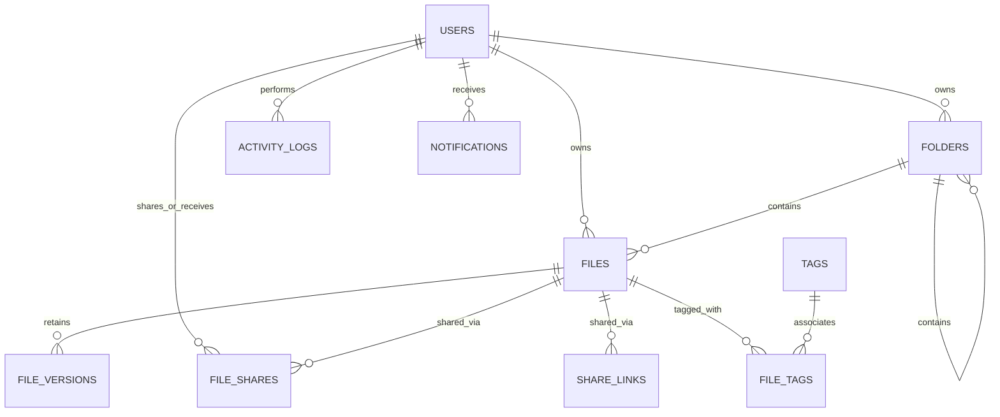

# CloudVault Database Schema & Models Documentation

## 1. Overview

CloudVault uses a relational data model designed with **SQLAlchemy 2.0** and managed with **Alembic** migrations. The schema supports strict referential integrity, cascading soft deletes, cryptographic hashing, and granular access control.

---

## 2. Entity-Relationship (ER) Diagram

---

## 3. Detailed Table Specifications

### 3.1 `users`
Represents registered users in the system.

| Column | Type | Constraints | Description |
|---|---|---|---|
| `id` | `UUID` | PRIMARY KEY | Unique user identifier |
| `email` | `VARCHAR(255)` | UNIQUE, NOT NULL, INDEX | Primary login email |
| `password_hash` | `VARCHAR(255)` | NOT NULL | Argon2id cryptographic hash |
| `full_name` | `VARCHAR(255)` | NOT NULL | User's display name |
| `storage_quota_bytes` | `BIGINT` | NOT NULL, DEFAULT 5GB | Total quota assigned |
| `storage_used_bytes` | `BIGINT` | NOT NULL, DEFAULT 0 | Current aggregated storage |
| `is_active` | `BOOLEAN` | NOT NULL, DEFAULT TRUE | Account active flag |
| `is_superuser` | `BOOLEAN` | NOT NULL, DEFAULT FALSE | Administrative privilege flag |
| `created_at` | `TIMESTAMP` | NOT NULL, DEFAULT NOW() | Account creation timestamp |
| `updated_at` | `TIMESTAMP` | NULLABLE | Last profile update |

---

### 3.2 `folders`
Represents hierarchical folder trees.

| Column | Type | Constraints | Description |
|---|---|---|---|
| `id` | `UUID` | PRIMARY KEY | Unique folder identifier |
| `name` | `VARCHAR(255)` | NOT NULL | Folder directory name |
| `owner_id` | `UUID` | FK -> `users.id`, NOT NULL | Folder creator |
| `parent_id` | `UUID` | FK -> `folders.id`, NULLABLE | Self-referencing parent folder |
| `is_trashed` | `BOOLEAN` | NOT NULL, DEFAULT FALSE | Soft delete flag |
| `trashed_at` | `TIMESTAMP` | NULLABLE | Soft delete timestamp |
| `created_at` | `TIMESTAMP` | NOT NULL, DEFAULT NOW() | Creation timestamp |
| `updated_at` | `TIMESTAMP` | NULLABLE | Last update timestamp |

---

### 3.3 `files`
Stores master file metadata.

| Column | Type | Constraints | Description |
|---|---|---|---|
| `id` | `UUID` | PRIMARY KEY | Unique file identifier |
| `owner_id` | `UUID` | FK -> `users.id`, NOT NULL | File creator/owner |
| `folder_id` | `UUID` | FK -> `folders.id`, NULLABLE | Parent folder location |
| `original_filename` | `VARCHAR(255)` | NOT NULL | Client's original filename |
| `storage_key` | `VARCHAR(512)` | NOT NULL, UNIQUE | Internal blob storage reference |
| `mime_type` | `VARCHAR(128)` | NULLABLE | Detected MIME type |
| `size_bytes` | `BIGINT` | NOT NULL | File size in bytes |
| `checksum` | `VARCHAR(64)` | NULLABLE | SHA-256 cryptographic digest |
| `is_starred` | `BOOLEAN` | NOT NULL, DEFAULT FALSE | Favorite/star flag |
| `is_trashed` | `BOOLEAN` | NOT NULL, DEFAULT FALSE | Soft delete flag |
| `trashed_at` | `TIMESTAMP` | NULLABLE | Deletion timestamp |
| `current_version` | `INTEGER` | NOT NULL, DEFAULT 1 | Active version number |
| `created_at` | `TIMESTAMP` | NOT NULL, DEFAULT NOW() | Upload timestamp |
| `updated_at` | `TIMESTAMP` | NULLABLE | Last metadata update |

---

### 3.4 `file_versions`
Retains complete historical version snapshots.

| Column | Type | Constraints | Description |
|---|---|---|---|
| `id` | `UUID` | PRIMARY KEY | Unique version identifier |
| `file_id` | `UUID` | FK -> `files.id`, NOT NULL | Parent file record |
| `version_number` | `INTEGER` | NOT NULL | Incremental version number |
| `storage_key` | `VARCHAR(512)` | NOT NULL | Storage key for this specific snapshot |
| `size_bytes` | `BIGINT` | NOT NULL | Snapshot size in bytes |
| `checksum` | `VARCHAR(64)` | NULLABLE | SHA-256 digest of this version |
| `uploaded_by` | `UUID` | FK -> `users.id`, NULLABLE | Uploader of this revision |
| `created_at` | `TIMESTAMP` | NOT NULL, DEFAULT NOW() | Revision timestamp |

---

### 3.5 `file_shares` & `share_links`
Manages direct user-to-user sharing and public link generation.

- **`file_shares`**: Direct user authorization (`permission`: `viewer` or `editor`).
- **`share_links`**: Public tokenized URLs (`permission`: `view` or `download`), optional Argon2id `password_hash`, optional `expires_at`, and `max_downloads` with `download_count` tracking.

---

### 3.6 `tags` & `file_tags`
Enables arbitrary tag-based indexing and categorization.

- **`tags`**: Unique tag label per user.
- **`file_tags`**: Many-to-many junction table between `files` and `tags`.

---

### 3.7 `activity_logs`
Chronological audit trail of all file and security events (e.g., `file_upload`, `file_download`, `file_share`, `file_trash`, `version_restore`).
