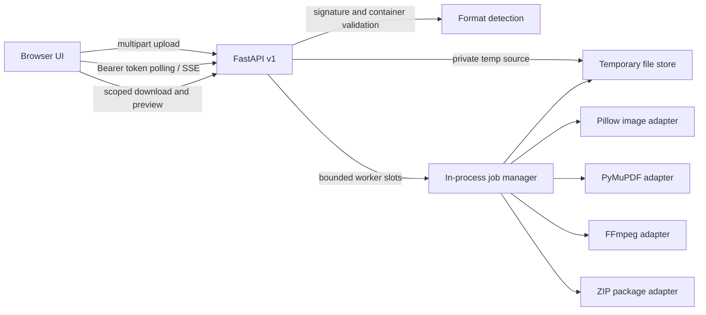

# Architecture

SmartCompress separates the client from the compression engine through a same-origin, versioned HTTP API. The current deployment is one Python web process with static browser assets; the API and format adapters are not tied to the UI framework.

## Ownership boundaries

- `apps/web/` contains the accessible responsive UI, form validation, drag-and-drop, upload progress, job polling, previews, downloads and batch download.
- `services/compressor/api.py` owns versioned request/response shapes, upload limits, in-process rate limiting, random temporary paths, scoped Bearer-token access, job state, SSE, security headers and retention cleanup.
- `services/compressor/engine.py` owns signatures, container inspection, extension mismatch checks, quality/bitrate search and per-format adapters. It returns measured output paths and measured target status; it never mutates source files.
- `tests/` creates fixtures and exercises output validity, mismatch errors, job endpoints, scoped tokens, ZIP results, and media encoding.

## Job lifecycle

1. `POST /api/v1/files` streams the multipart body in bounded chunks into a random private directory and probes the file contents. It returns a random upload identifier plus an upload-scoped token.
2. `POST /api/v1/compression-jobs` validates that token and creates a new random job identifier and token. A bounded semaphore limits concurrent CPU work.
3. A worker runs the adapter in a thread. FFmpeg gets a bitrate budget and up to five candidates; image adapters search quality and bounded dimensions. PDF and archive operations remain lossless.
4. The job status exposes only safe result metadata. Its token is sent in an Authorization header for polling, cancellation, preview and download.
5. A periodic cleaner and startup sweep delete private job/upload directories after the configured retention period.

State and upload/job tokens are in process memory. Run only one API process as configured. Before scaling horizontally, replace in-memory state with a shared job store and queue, then private object storage. Workers should be isolated, unprivileged, and limited for CPU, memory, disk, processes and network egress.

## Client evolution

Expo/React Native can use the multipart and JSON APIs directly, then save downloaded results with platform file APIs. Tauri can wrap the same browser UI; offline desktop mode would package a Python service and FFmpeg as signed platform sidecars. Neither wrapper automatically makes this web build a native application. Local-only mobile processing requires native codec bindings and separate memory, sandbox and file-provider work.
